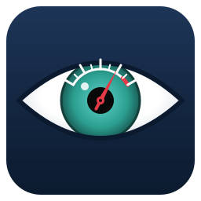

<p align="center">
  
</p>

<h1 align="center">CNS-OpenIrisDAC</h1>

# GENERAL INFORMATION

**CNS-OpenIrisDAC:** This project is a fork of [OpenIrisDAC](https://github.com/ryan-ressmeyer/OpenIrisDAC). It is modified to work in the environment of the [Usrey Lab](https://usreyneuroscience.ucdavis.edu/) at the UC Davis Center for Neuroscience ([CNS](https://neuroscience.ucdavis.edu/)).

**Version:** As of Nov 2026, we are still under development. The **master** branch is where all the action is.

**Short description:** This application is an analog output client for the [Dual Purkinje Image eye tracker](https://github.com/ryan-ressmeyer/OpenIrisDPI) developed by Ryan Ressmeyer. Check that project out, along with its [wiki](https://github.com/ryan-ressmeyer/OpenIrisDPI/wiki), a terrific resource. Our tracker hardware differs from the wiki model in some respects, but the core of the system (camera, IR source, OpenIrisDPI software) is identical to the wiki design.

___

# PROJECT OVERVIEW

**Full description:** This program is a client of the streaming tracking data from the OpenIrisDPI control program. It receives per-frame eye data (pupil, corneal reflection P1, and the fourth Purkinje image P4) over UDP, applies a per-eye calibration, and writes the result as analog voltages on a DAC. A data acquisition system (e.g. Spike2) records those voltages to monitor eye position during an experiment.

For the tracked eye, the program computes and outputs:

- **CR** eye position: P1 − pupil center (x, y).
- **DPI** eye position: P1 − P4 (x, y).
- **Pupil** size (pupil area).

Each signal has its own calibration (x/y bias, x/y gain, rotation). You can adjust it by hand in the GUI, or fit it automatically during a calibration session that a stimulus program drives (see [Calibration](#calibration)). The program can also record the raw frame data to a binary file (see [Recording data](#recording-data)).

**Project Organization:**

| File | Purpose |
| --- | --- |
| `gui.py` | Main application (PySimpleGUI). Entry point. |
| `globalstate.py` | Shared state, config file load and save, DAC discovery. |
| `data_pipeline.py` | Per-frame loop: computes positions, writes DAC outputs, feeds calibration and recording. |
| `open_iris_client.py` | UDP client for OpenIrisDPI and the `EyesData` data model. |
| `generator.py` | Frame sources: live OpenIrisDPI, simulated data (`--fake`), or replay of recorded pickles. |
| `calibrator_comm.py` | TCP server for calibration and recording commands from the stimulus program. |
| `calibrator_analyzer.py` | Fits calibration parameters from fixation and button-press data. |
| `diothread.py` | Polls the DAC's digital inputs (button presses) during calibration. |
| `recorder.py` | Binary data recording, plus a reader for the recorded files. |
| `dac_common.py`, `dac.py`, `nodac.py` | DAC abstraction: AccesIO USB / NI-DAQmx hardware, and a no-hardware stand-in. |
| `eye_tracker_settings.py` | Reads OpenIrisDPI's `EyeTrackerSettings.xml` to detect frame rate and tracked eye. |
| `icon.svg`, `icon.ico` | Application icon. `icon.svg` is the source; `icon.ico` (16–256 px) is used for the GUI windows on Windows. |

___

# INSTALLATION

**Step by step instructions:**

1. Clone the GitHub repo to the computer.
2. Set up a virtual env using your preferred method. Development was done using Python 3.12, and we recommend that version.
3. Install the dependencies into the virtual env:
```shell
$ pip install numpy scipy PySimpleGUI tomlkit platformdirs xmltodict numpy_ringbuffer
$ pip install wmi        # Windows only: locates a running OpenIris.exe
$ pip install nidaqmx    # only if using an NI DAC
```

**System requirements:**

To drive real DAC hardware, the application must run on Windows (on the same computer as OpenIrisDPI, or one that can reach it over the network).

If you use the [AccesIO USB-AO16-8E](https://accesio.com/usb-data-acquisition-daq-products/#cat-analog-output-usb), install its drivers. NI-DAQmx devices are partially supported. Any other DAC needs its own dac module (see `dac.py` and `nodac.py`).

Without hardware, you can develop and test on any platform using the simulated data source and the no-DAC backend (see below).

___

# USAGE

**Running the program:**

```shell
python gui.py [options]
```

On startup the program asks you to select a *subject*. The subject determines which config file is loaded (see [Configuration](#configuration)). To skip the prompt, pass `--subject`.

| Option | Default | Description |
| --- | --- | --- |
| `--subject NAME` | (prompt) | Subject whose config file is loaded. |
| `--address IP` | `localhost` | Address of the OpenIrisDPI server. |
| `--port N` | `9003` | UDP port of the OpenIrisDPI server. |
| `--cal-port N` | `9292` | TCP port of the calibrator command server. 0 disables the server. |
| `--fps N` | (auto) | Capture frame rate. By default it is read from `EyeTrackerSettings.xml`. |
| `--eye Left\|Right\|Both` | (auto) | Tracked eye. By default it is read from `EyeTrackerSettings.xml`. |
| `--tracker-folder DIR` | (auto) | Folder containing `EyeTrackerSettings.xml`. By default it is found from the running `OpenIris.exe`. |
| `--record PREFIX` | | Start recording binary data at startup, using this filename prefix. |
| `--fake` | | Use simulated eye data instead of OpenIrisDPI. Defaults to 500 fps and the Left eye. |
| `--fake-speed DEG_PER_S` | `2.0` | Simulated gaze speed along its Lissajous path. |
| `--fake-cr-noise DEG` | `0.05` | Simulated CR noise amplitude. |
| `--fake-dpi-noise DEG` | `0.05` | Simulated DPI noise amplitude. |

The environment variable `DAC_BACKEND` selects the DAC code: `dac` (real hardware, the default on Windows) or `nodac` (no hardware, the default elsewhere).

**Usage examples:**

```shell
# Normal use on the rig
python gui.py --subject monkeyA

# OpenIrisDPI on another machine, start recording immediately
python gui.py --subject monkeyA --address 192.168.1.20 --record session1

# Development without tracker or DAC (any OS)
DAC_BACKEND=nodac python gui.py --fake --subject default
```

**The GUI:**

- **Left Eye tab:**
  - Calibration controls (bias, gain, rotation) for CR, DPI, and pupil.
  - A **Zero** button for CR and for DPI, which sets the bias so the current eye position reads as zero.
  - The main graph of calibrated eye position, in degrees.
  - **Mouse Mode:** outputs follow the mouse over the graph, for testing the analog chain.
  - The **Recording** controls.
- **Calibration tab:** raw and fitted calibration points, plus buttons to fit, edit points, accept the fit, or clear.
- **Settings tab:** the data folder for recordings, and the assignment of DAC output channels to signals.
- **File menu:** Save Config, Load Config, and Exit. If the config changed, the program asks whether to save it on exit or before another config is loaded.
- **Status bar:** frames received, frame rate, and missed frames.

Units: values on the DAC are in **volts**. The main graph shows **degrees**, converted using the volts-per-degree factors from the config, which the stimulus program can update with `DEGPERVOLT`.

## Configuration

Each subject has a TOML config file at `~/.dpidac/<subject>/config.toml`. It is created with default values if it does not exist. It holds:

- the calibration parameters for each signal
- the calibration analysis settings and volts-per-degree factors
- the DAC channel assignments
- the recording data folder

The `config.toml` in the repo is only a sample. To create or inspect a config without starting the GUI:

```shell
python globalstate.py --subject monkeyA
```

## Calibration

The stimulus program (`fixstim`) runs a calibration session. It runs alongside Spike2 on the DAQ computer. Spike2 has no built-in networking, so commands travel over a serial port and a serial-to-TCP bridge to this program's calibrator server (`--cal-port`). Button presses from the behavior rig are read from the DAC's digital inputs.

Protocol: the client sends `HELLO;` and the server replies `OK;`. The client then sends semicolon-terminated commands, and each command gets a reply of `OK;` or `ERROR: <reason>;`.

| Command | Action |
| --- | --- |
| `calstart` | Begin a calibration session. |
| `calstop` | End the calibration session. |
| `F x,y,d,c` | Fixation point on at (x, y) degrees, with diameter d and color c. |
| `X` | Fixation point off. |
| `DEGPERVOLT dx,dy` | Set the degrees-per-volt scale for x and y. |
| `recstart [prefix]` | Start binary recording. Without a prefix, the GUI's prefix is used. |
| `recstop` | Stop binary recording. |

During a session, frames are matched against fixation and button-press events, and new calibration parameters are fitted. Review the fit on the Calibration tab and accept it to apply it.

## Recording data

Recording saves every frame received from OpenIrisDPI: the raw data for both eyes plus the Extra ints and doubles. You can start and stop it three ways:

- the **Start/Stop Recording** button on the Left Eye tab, using the prefix typed beside it
- the `recstart` / `recstop` calibrator commands
- the `--record PREFIX` command-line option, which starts recording when the program launches

Files are written to the data folder set on the Settings tab. The folder is saved in the config and defaults to the project folder. Each recording creates two files:

```
<prefix>-yyyy-mm-dd-HHMMss.dat    binary frame data
<prefix>-yyyy-mm-dd-HHMMss.toml   copy of the config in effect when recording started
```

The timestamp is the local time when the file was opened. An existing file is never overwritten. While a calibration session is active, the calibration values are written into the Extra fields before the frame is recorded:

- `ints[8]`: DIO bits
- `doubles[5]`, `doubles[6]`: volts per degree, x and y
- `doubles[7]`, `doubles[8]`: fixation point x and y

The `.toml` copy reflects the settings at the start of the recording, including unsaved changes. Calibration changes made during the recording are not captured in it.

### Binary file format (`.dat`, version 1)

All values are little-endian with no padding. The file is a 64-byte header followed by one fixed-size record per frame.

**Header (64 bytes)**

| Offset | Type | Field |
| --- | --- | --- |
| 0 | `char[8]` | Magic, `OIDACREC` |
| 8 | `uint16` | Format version (1) |
| 10 | `uint16` | Header size in bytes (64). Records start at this offset. |
| 12 | `uint32` | Record size in bytes (190) |
| 16 | `float64` | Recording start time, Unix epoch seconds |
| 24 | `uint32` | Capture frame rate (fps) |
| 28 | `char[8]` | Tracked eye (`Left`, `Right`, `Both`), ASCII, NUL-padded |
| 36 | — | Zero padding to 64 |

**Record (190 bytes)**

| Offset | Size | Contents |
| --- | --- | --- |
| 0 | 41 | Left eye (layout below) |
| 41 | 41 | Right eye (layout below) |
| 82 | 36 | Extra ints: `int32[9]` (`Int0`–`Int8`) |
| 118 | 72 | Extra doubles: `float64[9]` (`Double0`–`Double8`) |

**Eye data (41 bytes)**

| Offset | Type | Field |
| --- | --- | --- |
| 0 | `int64` | Frame number |
| 8 | `float32` | Pupil center x (pixels) |
| 12 | `float32` | Pupil center y (pixels) |
| 16 | `float64` | Pupil area (width × height, pixels²) |
| 24 | `float32` | CR (P1) x |
| 28 | `float32` | CR (P1) y |
| 32 | `float32` | P4 x |
| 36 | `float32` | P4 y |
| 40 | `uint8` | Error flags: bit 0 = no CR, bit 1 = no P4, bit 2 = no data for this frame |

When an error flag is set, the corresponding coordinates are 0. A trailing partial record can occur if the program did not exit cleanly, and readers should ignore it.

**Reading a file:** `recorder.py` provides `read_recording()`, which returns the header as a dict and the records as a numpy structured array:

```python
from recorder import read_recording
header, rec = read_recording("session1-2026-11-17-131605.dat")
t = rec['left']['frame_number'] / header['capture_fps']
cr_x = rec['left']['cr_x'] - rec['left']['pupil_x']
dio = rec['ints'][:, 8]
```

To print a summary from the command line:

```shell
python recorder.py session1-2026-11-17-131605.dat
```

In other environments, use the tables above. For example, in MATLAB: skip `header_size` bytes, then read records of `record_size` bytes.

**Known limitations:**

- Only the left eye is fully supported for calibration and analog output. Both eyes are recorded, but right-eye output channels cannot yet be assigned in the GUI.
- Writes are buffered, so if the program is killed (rather than exited normally) during a recording, up to about 0.7 s of data at 500 fps can be lost.
- There is no automated test suite.

___

# LICENSE

See the [LICENSE](LICENSE.md) file in this repository.

___

# CONTACT INFORMATION

- **Name:** Daniel Sperka
- **Institution:** UC Davis Center for Neuroscience
- **Email:** djsperka@ucdavis.edu

___

# ACKNOWLEDGEMENTS

**Funding:** Dr. Sperka is supported by NEI Vision Core Grant P30 EY012576.

**Acknowledgements:** This work relies on the [OpenIrisDPI](https://github.com/ryan-ressmeyer/OpenIrisDPI) project by Ryan Ressmeyer, and would not be possible without his helpful comments and suggestions along the way.
